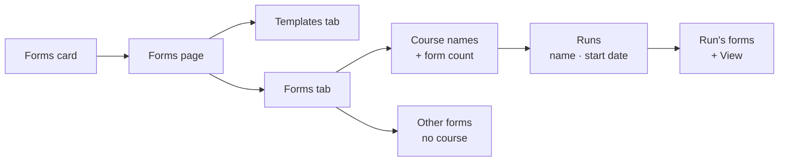

# TAT-481 Super Admin Forms Browser

Jira: [TAT-481](https://cryptonic-art.atlassian.net/browse/TAT-481) · *Highest* · Story · Ready for Dev · under epic **TAT-314 Forms** · reporter dania.baradie. Sibling of [[TAT-484 Assigned Forms Inbox]].

> [!info] Split (2026-10-08)
> **Frontend: me, in [[tat-ws]].** **Backend: Hamza Dawahreh**, the Jira assignee, in [[tat-app-ws Backend]]. The frontend was first built against guessed endpoints; Hamza's backend landed 2026-10-10 (`0001ef0c`) and the frontend was moved onto it 2026-10-11. Lesson kept: agree shapes early rather than guess them (see [[Patterns - Architecture & Boundaries]]).

## Requirement

A **read-only catalogue** of templates and forms for the Super Admin. Nothing is filled, edited or approved here.

| Screen | Shows | Controls |
|---|---|---|
| SA dashboard | New **Forms** action card (AC-01/02) | Opens the Forms page |
| Forms → **Templates** tab | Every form template: name + **View** (AC-04/05) | Search by name (AC-06) |
| Forms → **Forms** tab | A **Courses** button + all other forms: name + **View** (AC-07/08) | Search by name, sort newest↔oldest (AC-09/10) |
| **Courses** page | Only courses that have forms: course name + form count (AC-11/12) | Search by course name (AC-13) |
| Course **Forms** page | That course's forms: name + **View** (AC-14→16) | Search by name (AC-17) |

Every search filters live to the current page's records (AC-18), and an empty result shows an empty state (AC-19).

## Navigation — changed twice outside Jira

- **2026-10-08 (from me):** aircraft (with course count) → that aircraft's courses (name + date) → forms, because same-named courses must be told apart.
- **2026-10-11 (decision, from me):** **superseded by Hamza's backend**, which groups by **course name** (with form count) → that name's **runs**, labelled with the course **start date** → forms. There is no aircraft level. Adopted as built: it is the real API, and it still separates same-named courses by date.

Jira still describes the original Courses-button flow (as of 2026-10-11).

## Backend — Hamza, [[tat-app-ws Backend]] `0001ef0c` "enrollment forms" (2026-10-10)

All Super Admin routes need `FMVC`. Responses are `{ data, totalSize }`, **unpaginated**, and only `search` / `sort` (`newest` | `oldest`, by `updatedAt`) are accepted — the API runs `forbidNonWhitelisted`, so any other query parameter is a 400.

| Route | Returns |
|---|---|
| `GET /forms/templates` · `/forms/templates/:id` | `{ id, name, formType, licenseId, referenceId, docxFileKey, description, … }` |
| `GET /forms/catalog` | forms with no course |
| `GET /forms/course-groups?search` | `{ courseName, formCount }` — no sort |
| `GET /forms/course-groups/:courseName/runs` | `{ courseId, courseName, courseDate (= startDate), formCount }` — no search or sort |
| `GET /forms/by-course/:courseId` | that run's forms |
| `GET /forms/:id` | one form, read-only |

Dashboard code is `FRM`, shared with the five TAT-484 roles. Six templates are seeded (Application + Planning Sheet × CARC / EASA / GCAA). **Their `docxFileKey` and `referenceId` are placeholders — the Word files are not uploaded** (seed comment, as of 2026-10-11).

## Frontend — rebuilt on the real API 2026-10-11 ([[tat-ws]] `015a66c`, pushed to `origin/dev` + `origin/prepod` 2026-10-11)

The 2026-10-08 build used guessed endpoints and an aircraft level; both were replaced, and the guessed hooks deleted.

- Routes (SA only): `/forms?tab=templates|forms`, `/forms/courses` (course names), `/forms/courses/:name` (runs), `/forms/runs/:id` (a run's forms), `/forms/view/:id`, `/forms/templates/:id`.
- The `Forms` card links to `/forms` for Super Admin and `/my-forms` for everyone else.
- **View is built:** a read-only on-screen layout of the form's data (`FormView`), shared with [[TAT-484 Assigned Forms Inbox|TAT-484]]. A template's View shows the blank layout and its reference ID. Word output waits for the real `.docx` files.
- **Restyled to the Jira mockups 2026-10-11** (five PNGs attached to TAT-481, which the ticket text does not mention — I found them only when asked). Card grids with a form thumbnail and a View button; the Forms tab opens with a **Courses ›** card, then the forms with no course; the Courses page uses course cards with "N Forms". Search sits top-right; status filters were dropped. A newest/oldest sort stays on form lists, for AC-10.
- **One deviation from the mockups, by decision:** a runs level (dated cards) sits between a course name and its forms. The mockup goes straight from course to forms, but Hamza's API groups by name, and dates are how same-named courses are told apart.
- **The form View is laid out like the paper form:** bordered label | value rows, blue section bars, the Application's TYPE | B1 | B2 | OTHER table, the declaration, signatures, stamp, and `PAGE 1/1` + reference ID in the footer.
- Kept from the 2026-10-08 browser check: skeletons key on `isPending` (a waiting query is not "empty", and the server/client render match), and every page has the repo's `useMounted()` guard.

**Status (2026-10-11): opened as SA against staging (Hamza's API).** Exercised: the Templates tab lists the six seeded templates as cards; a template's View renders the blank Planning Sheet layout with its declaration; the Forms tab shows the Courses card and no other forms; the Courses page shows its empty state (no form has been submitted on staging yet). Fixed from your screenshot: page titles sat directly on the app's dark blue banner and were unreadable — the header now lives inside the white `LowerShadowCard`, as other pages do. **Not exercised:** any course, run or form with real data, sort and search results, the inbox, the trainee flow. Staging already runs `0001ef0c`: `/forms/templates` returns 403 without a login, where an unknown route returns 404.

## Backend notes for Hamza (not yet sent)

- `approvalDetails.approvedBy` is a bare user id, so no screen can show the approver's name.
- Grouping uses the course **start date**; a same-named course with no start date gets no date, so two such runs look identical.
- The Word templates in the seed are placeholders, and so are the reference IDs — the footer shows `TAT-APP-EASA-001` where the form says `TAT Form 004 09.20 ISSUE/REV. 01/01` (real numbers in [[TAT-482 + TAT-483 Enrollment Forms]]).
- **"Prepared by – Signature" is always blank for a course a Super Admin created:** `buildPreparedByFields` only reads the creator's TM / EM / QM / AM `signatureImage`. Seen on staging 2026-10-11 ("new course1", created by a Super Admin).

## Spec gaps (raise with the reporter)

- **Template sort.** Scope says templates and forms sort by time; the ACs only give the Forms tab a sort (AC-10). Does the Templates tab sort?
- **Course Forms sort.** Scope says course forms sort by time; AC-17 gives search only.
- **What "View" opens.** A template preview, a filled form instance, or both? AC-05 vs AC-08 may mean different renderers.
- **Template vs form.** Does a "form" mean a filled instance of a template? The data model has to say so before the tabs can be built (see [[TAT-484 Assigned Forms Inbox]], which needs the same answer).

## Action Items

- [x] Build the Forms card, the Templates/Forms tabs and the drill-down (2026-10-08, rebuilt on the real API 2026-10-11)
- [ ] Open every SA page in a browser against Hamza's API
- [x] Build View — on-screen layout of the form data (2026-10-11)
- [x] Move to Hamza's real endpoints and shapes (2026-10-11)
- [ ] Raise the spec gaps above with dania.baradie

## Related

- [[TAT-484 Assigned Forms Inbox]] — same epic; that one is the role-side inbox with a status workflow
- [[Proposal Generator - Word Template Spike]] · [[Decision - Word Templates for Generated Documents]] · [[Word Template Document Generation]] — the uncommitted Word-template work in [[tat-ws]], part of this forms effort (per me, 2026-10-08)
- [[Gotchas - Forms & Approval]] — earlier form traps
- [[tat-ws]] · [[tat-app-ws Backend]] · [[TAT Platform]]
