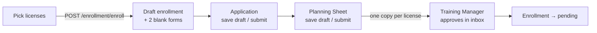

# TAT-482 + TAT-483 Enrollment Forms

Jira: [TAT-482](https://cryptonic-art.atlassian.net/browse/TAT-482) Application for Training/Examinations Form · [TAT-483](https://cryptonic-art.atlassian.net/browse/TAT-483) Type Training Planning Sheet Form · both *Highest*, Ready for Dev, under epic **TAT-314 Forms**, reporter dania.baradie. One note for both: they are one flow. Siblings: [[TAT-481 Super Admin Forms Browser]] · [[TAT-484 Assigned Forms Inbox]].

> [!info] Split
> **Frontend: me, in [[tat-ws]].** **Backend: Hamza Dawahreh**, shipped in [[tat-app-ws Backend]] `0001ef0c` "enrollment forms" (2026-10-10).

## The flow (as built by the backend)

- `POST /enrollment/enroll` now takes **only `{ courseId, licenseIds }`** and creates a `draft` enrollment. Calling it again for the same course returns the existing draft, so a trainee resumes by signing up again.
- `GET /enrollment/draft/:id/forms`, `PATCH …/forms/:formId/draft`, `POST …/forms/:formId/submit` (trainee only).
- The Planning Sheet cannot be submitted before the Application. Submitting copies the form once per selected license (AC-14/15, AC-21/22).
- `data` keys — Application: `name, idNumber, dateOfBirth, placeOfBirth, employer, tel, email, signatureImage, date`. Planning Sheet: `studentName, studentId, category, amlNumber, signatureImage, date`, plus arrays `sameCategoryRatings, otherCategoryRatings, experience` (item shape not defined by the backend). **Only `signatureImage` is required on submit since 2026-10-15** — the other required-field checks were removed at my request: [[Forms - No Field Validation & Export to Word]].
- The backend fills and locks: static header, course name, category, aircraft type, and "Prepared by" (course creator's name and signature, course creation date).

> [!warning] Breaking change
> The old enroll payload (passport, nationality, date of birth, documents) is gone, and the API rejects unknown fields. **Staging already runs `0001ef0c`** (as of 2026-10-11), so the deployed tat-ws sign-up fails there until this frontend ships.

## Decisions (2026-10-11, from me)

- **Trainees sign by drawing on screen.** New dependency `signature_pad@5.1.4` (stable, no dependencies; the React wrapper's only `latest` is an alpha). The drawing uploads as a PNG through `/file/upload-file` (category `signature`), and the returned public URL is what `signatureImage` stores — the same as profile signatures.
- **Declarations and static wording come from the approved forms.** They turned out to be attached to the Jira tickets (CARC / EASA / GCAA `.docx` plus a filled PDF each). The declarations are identical across the three licenses, so filling once works; they are copied word for word into `forms/utils/formDeclarations.ts`.

## Frontend — built 2026-10-11 ([[tat-ws]] `015a66c`, pushed to `origin/dev` + `origin/prepod` 2026-10-11)

- Sign-up drawer (`components/common/CourseSignUp/CourseSignUP.tsx`) rewritten: pick licenses → **Continue to Enrollment Forms** → `/enrollment-forms/:id`. The passport and document steps were removed with their components (`AddPassport`, the sign-up `AddDocument`, `schema/enrolment.schema.ts`).
- `/enrollment-forms/:id` (trainee): a three-step stepper — Application, Planning Sheet, Training Manager review. Each form has Save Draft and Submit; locked fields show read-only.
- Planning Sheet lists: **each entry is one line of text** — which is how the approved form lays them out.
- The Application's course section is the form's **TYPE | B1 | B2 | OTHER** table, ticked from the course category (`B1`, `B2` or `B1/B2`).

**Status (2026-10-11): trainee flow run end to end on staging** (go-ahead given; trainee account, course "new course1", EASA, test data "Test Trainee" / `TEST-0001`, draft enrollment `6acb463a4b2d97a895b44c88`). Exercised: sign-up drawer → draft created → Application with the B1/B2 table and declaration → Save Draft (survives a reload, signature included) → Submit → Planning Sheet with list entries and declaration → Submit → "waiting for Training Manager approval". Then, as SA, the catalog showed new course1 · 2 Forms → run 22 Sep 2026 → both forms, each rendering as the paper form.

**Fixed during the run:**
- **Signatures uploaded as solid black boxes.** The upload service stores images as `.jpg`, so the pad's transparent background turned black. The pad now draws on white (and scales for high-DPI screens).
- **Date of birth could not reach a real birth year** — the shared date picker has no year selector (the old sign-up had the same flaw). Now a native date input; `"date"` added to the shared `RHFTextInput` type union (one word, runtime already passed it through).
- The Date field stretched to the signature pad's height (the shared date input's container is `h-full`); wrapped.

**After Training Manager approval (2026-10-11, see [[TAT-484 Assigned Forms Inbox]]):** the course page shows **Pending approval** — the enrollment really moved `draft` → `pending`. The trainee's forms page still said "waiting for Training Manager approval", because approval updates the license copies, not the working draft the page reads. **Fixed:** the last step now reads the trainee's enrollment status from `GET /courses/public/:id` (`enrollmentStatus.isPending` = exactly `pending`, `isEnrolled` = `enrolled`) and shows "Planning Sheet approved — waiting for final approval" or "You are enrolled", with every step checked. `GET /courses/:id` was tried first and returns **403 for trainees**.

**Not exercised:** a multi-license enrollment (one copy per license), the final enrollment approval, the stamp.

## Real footer numbers (from the attached forms)

Hamza's seed uses placeholders such as `TAT-APP-CARC-001`. The forms say:

| Form | CARC | EASA | GCAA |
|---|---|---|---|
| Application | TAT Form 004 08.26 ISSUE/REV. 01/01 | TAT Form 004 09.20 ISSUE/REV. 01/01 | TAT Form 004 09.20 ISSUE/REV. 01/01 |
| Planning Sheet | TAT Form 008 08.26 ISSUE/REV. 02/01 | TAT Form 008 04.24 ISSUE/REV. 01/02 | TAT Form 008 09.26 ISSUE/REV. 01/03 |

## Not done

- Word output per license with the right reference ID in the footer (AC-19 / AC-25) — the backend's `.docx` templates are placeholders.

## Action Items

- [x] Add the declarations and the B1/B2/OTHER table from the approved forms (2026-10-11)
- [ ] Ask Hamza to seed the real footer numbers and upload the six `.docx` files
- [ ] Run the full flow on staging (trainee → both forms → TM approval) once approved to write test data

## Related

- [[Forms - No Field Validation & Export to Word]] — validation removed and Export to Word for both forms

- [[TAT-481 Super Admin Forms Browser]] · [[TAT-484 Assigned Forms Inbox]] — the same `Form` records, seen by the Super Admin and the five staff roles
- [[Decision - Word Templates for Generated Documents]] · [[Proposal Generator - Word Template Spike]] — the docxtemplater approach the backend's templates are meant for
- [[Gotchas - Forms & Approval]]
- [[Gotchas - Frontend Data & API Contracts]] · [[Gotchas - Frontend]] · [[Gotchas - Tooling & Method]] — the traps this work recorded (2026-10-11)
- [[Q4 2026]] — brag entry · competencies: [[Delivery & Scope Management]], [[Debugging & Root Cause Analysis]]
- [[tat-ws]] · [[tat-app-ws Backend]] · [[TAT Platform]]
