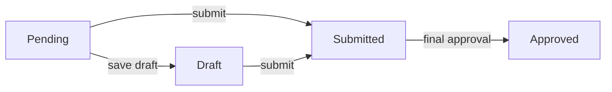

# TAT-484 Assigned Forms Inbox

Jira: [TAT-484](https://cryptonic-art.atlassian.net/browse/TAT-484) · *Highest* · Story · Ready for Dev · under epic **TAT-314 Forms** · reporter dania.baradie. Sibling of [[TAT-481 Super Admin Forms Browser]].

> [!info] Split (2026-10-08)
> **Frontend: me, in [[tat-ws]].** **Backend: Hamza Dawahreh**, the Jira assignee, in [[tat-app-ws Backend]]. The frontend was first built against guessed endpoints; Hamza's backend landed 2026-10-10 (`0001ef0c`) and the frontend was moved onto it 2026-10-11. Lesson kept: agree shapes early rather than guess them (see [[Patterns - Architecture & Boundaries]]).

## Requirement

**Who:** Instructor, Admin, Quality Manager, Training Manager, Examination Manager each get a **Forms** dashboard card (AC-01/02).

**List:** only forms assigned to the logged-in user (AC-03), each showing form name, related course when there is one, and status (AC-04/10). Any listed form can be opened (AC-12). Empty state, verbatim: *"No forms have been assigned to you yet."* (AC-11)

**Status flow:**

| Status | Meaning | Behaviour when opened |
|---|---|---|
| Pending | Assigned, needs this user's action, not started (AC-06) | Blank form |
| Draft | Started and saved, not submitted (AC-07/13) | Saved values, still editable (AC-14) |
| Submitted | Submitted, with approval or another step still to come (AC-08/15) | (not specified) |
| Approved | Last approval done (AC-09/16) | Approved values + approval details, **read-only** (AC-17/18) |

## Layout decision (2026-10-08, from me)

**One flat list, not the [[TAT-481 Super Admin Forms Browser|TAT-481]] drill-down.** The inbox is a to-do list: pending work must be visible without clicking through levels, and a flat list keeps AC-03/04/10 intact. Same-named courses are told apart by the course label (name · start date).

## Backend — Hamza, [[tat-app-ws Backend]] `0001ef0c` (2026-10-10)

- `GET /forms/inbox` → `{ data: { id, name, formType, status, relatedCourse, relatedCourseLabel, enrollmentId, licenseId, updatedAt }[], totalSize }`. **No search, filter, sort or pagination.**
- `GET /forms/inbox/:id` → the full form, read-only.
- `POST /forms/inbox/:id/approve` → **Training Manager only**, Planning Sheet only, status `submitted` only. Body `{ signatureImage, date?, notes? }`. Approves every license version and moves the enrollment from `draft` to `pending`; the TM's profile stamp is added automatically.
- **Who is "assigned":** every user holding one of the five roles is assigned **every** submitted form (`resolveFormsAssigneeIds`), including Application forms that need no action from them. This answers the "who assigns forms" gap, but it is not "forms that require an action from that user" (AC-06).
- Answers to earlier gaps, as built on 2026-10-10: only the Training Manager approves, and only the Planning Sheet; there is no rejection state. **Superseded as of 2026-10-18:** the course-forms service now has a Training Manager **Reject and Forward to QM** for the Classroom Assessment (`QUALITY_MANAGER_REVIEW` stage). When it landed was not checked. See [[Classroom Assessment Reject - Error Screen After Forwarding to QM]].

## Frontend — rebuilt on the real API 2026-10-11 ([[tat-ws]] `015a66c`, pushed to `origin/dev` + `origin/prepod` 2026-10-11)

- `/my-forms` (five roles) lists the inbox. **Restyled to the two Jira mockups 2026-10-11:** document icon + form name, course, status pill with a dot (Pending orange, Draft blue, Submitted grey, Approved green), a visible View button, no filters. The empty state uses the mockup's look and title ("No Results") with AC-11's wording ("No forms have been assigned to you yet."); the mockup's own sentence differs from AC-11. The guessed aircraft filter and `MYF` card were removed: the single `FRM` card now opens `/my-forms` for these roles.
- `/my-forms/:id` shows the form read-only (`FormView`, shared with TAT-481), with approval details once approved.
- **Training Manager approval panel** (decision 2026-10-11, from me): "Approved By" is the TM's own name, the signature is the one **saved on their profile** (`trainingManager.signatureImage`), plus date and optional notes. With no profile signature, Approve is disabled and the panel links to the profile.
- Fixed in passing: the frontend user type named the TM fields `signature` / `stamp`; the backend names them `signatureImage` / `stampImage`. Nothing read the old names.

**Status (2026-10-11): run on staging as a Training Manager (Tor TM Dev).** Exercised: the `Forms` card opens `/my-forms`; the inbox lists both test forms from [[TAT-482 + TAT-483 Enrollment Forms]] with course label and status; the Planning Sheet opens read-only; with **no profile signature** the panel blocks Approve and links to the profile (this account's `trainingManager` block was `null`); after you added one, **Approve** succeeded — status Approved in the page and the inbox, approval block filled with signature, date and note.

**Seen on staging, still open:**
- The Application stays **Submitted** forever — the backend gives it no approval step, so the AC-15 gap (status when nothing follows submit) is real, not theoretical.
- The approval block reads "Approved", not the approver's name — the API returns only `approvedBy` as an id.
- **No stamp** was added: the account had no `trainingManager.stampImage`. Training Manager profiles on staging can lack both signature and stamp, so check real TM profiles before release.
- Not exercised: a non-TM role's inbox, the trainee's view after approval, whether the enrollment actually moved to `pending`.

## Spec gaps (raise with the reporter)

- **Who assigns forms, and how.** *Answered by the backend:* everyone in the five roles gets every submitted form. Confirm with the reporter that this is intended.
- **Submit with no approval step.** AC-15 sets "Submitted" only *when* another step is required. What status does a form get when none is?
- **Submitted, from each side.** Can the submitter still edit or withdraw? Does the approver see the same form in *their* inbox, and what status is it in there?
- **Rejection.** There is no Rejected or returned state. What happens when an approver turns a form down? *(Partly answered 2026-10-18: a Classroom Assessment escalates to the Quality Manager. Other forms still have no reject.)*
- **Approver identity.** AC-16 says "an authorized user". Which role approves which form?
- **"Admin" role.** Listed separately from Super Admin. Confirm it maps to a real role in the role enum.
- **"Read-only by default" (AC-18).** "By default" suggests some override exists. Who has it?

## Action Items

- [x] Build the inbox list and filters (2026-10-08, rebuilt on the real API 2026-10-11)
- [x] Build the read-only form view and the Training Manager approval (2026-10-11)
- [ ] Open `/my-forms` as one of the five roles, and approve a Planning Sheet as a Training Manager
- [ ] Raise the spec gaps above with dania.baradie

## Related

- [[TAT-481 Super Admin Forms Browser]] — same epic; the SA catalogue reads the same template and form data
- [[TAT-485 Training Order Check List]] — same epic; the Admin checklist and its TM approval run through this inbox
- [[Classroom Assessment Reject - Error Screen After Forwarding to QM]] — the detail page refetched a form the TM had just handed to QM (2026-10-18)
- [[Gotchas - Forms & Approval]] — post-approval locking and approval-permission traps hit before, directly relevant to AC-16→18
- [[Proposal Generator - Word Template Spike]] · [[Decision - Word Templates for Generated Documents]] · [[Word Template Document Generation]] — the uncommitted Word-template work in [[tat-ws]], part of this forms effort (per me, 2026-10-08)
- [[tat-ws]] · [[tat-app-ws Backend]] · [[TAT Platform]]
